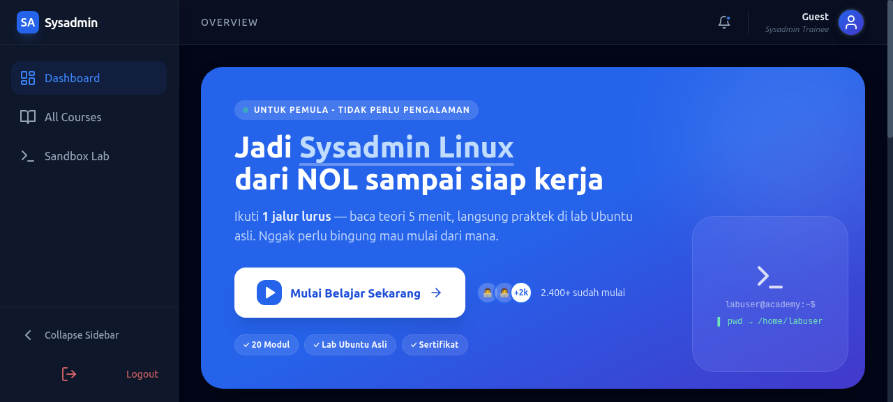
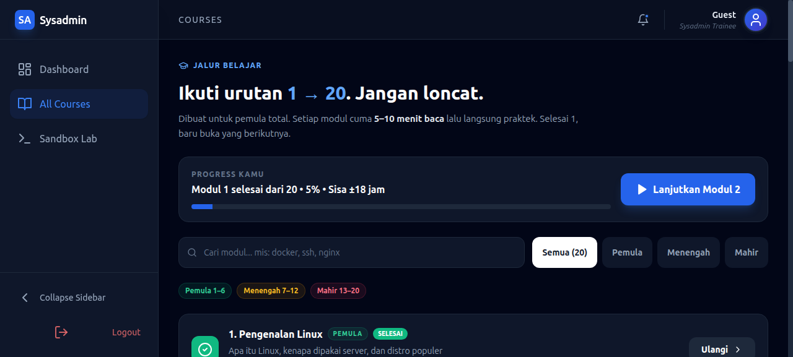

# Sysadmin Academy

Platform belajar sysadmin Linux dari pemula sampai mahir dengan teori + lab machine.

## Struktur Proyek

```
sysadmin-academy/
├── backend/               # FastAPI
│   ├── app/
│   │   ├── api/          # Endpoints
│   │   ├── core/         # Config & security
│   │   ├── db/           # Database
│   │   ├── models/       # DB models
│   │   ├── schemas/      # Pydantic schemas
│   │   ├── services/     # Business logic
│   │   └── main.py       # App instance
│   ├── main.py           # Entry point
│   ├── Dockerfile
│   └── requirements.txt
│
├── frontend/              # React + Vite + Tailwind
│   ├── src/
│   │   ├── pages/        # Dashboard, Courses, Lab, etc
│   │   ├── components/   # Reusable components
│   │   ├── api/          # API client
│   │   ├── hooks/        # Custom hooks
│   │   ├── store/        # State management
│   │   └── main.jsx      # Entry
│   ├── package.json
│   ├── vite.config.js
│   ├── Dockerfile
│   └── tailwind.config.js
│
├── lab-image/             # Ubuntu lab machine
│   └── Dockerfile
│
├── docker-compose.yml     # All services
├── courses.md             # Course content (20 modules)
└── lab-guide.sh          # Lab exercises

docs/
└── screenshots/
    ├── 01-dashboard.png   # Tampilan awal dashboard
    └── 02-courses.png     # Tampilan daftar course
```

## Tech Stack

### Backend
- FastAPI 0.111.0
- SQLAlchemy 2.0 (ORM)
- PostgreSQL/SQLite
- JWT Authentication
- Pydantic v2

### Frontend
- React 18.2
- Vite 5.3
- React Router v6
- Tailwind CSS 3.4
- Zustand (state management)
- Axios (HTTP client)

### Lab
- Ubuntu 22.04
- SSH Server
- Pre-installed tools

### Deployment
- Docker
- Docker Compose
- Development ready

## Quick Start

### Backend
```bash
cd backend
cp .env.example .env
pip install -r requirements.txt
python main.py
```

API: http://localhost:8000/docs

### Frontend
```bash
cd frontend
npm install
npm run dev
```

UI: http://localhost:5173

### Lab Machine
```bash
docker-compose up -d lab
ssh -p 2222 labuser@localhost  # password: labuser123
```

### All Services
```bash
docker-compose up -d
```

## Screenshots

### Dashboard Tampilan Awal


### Daftar Course


## Courses

20 modules dari dasar sampai advanced:
1. Pengenalan Linux
2. CLI Basics
3. User & Group Management
4. File System
5. Package Management
6. Process Management
7. Networking
8. SSH & Remote Access
9. Systemd Services
10. System Monitoring
... dan 10 modul lagi sampai Production Environment

Setiap module punya:
- Teori lengkap
- Command examples
- Lab exercises
- Quiz/Assessment

## Security Features

- Password hashing dengan bcrypt
- JWT token authentication
- CORS protection
- SQL injection prevention
- SSH hardening pada lab machine
- Firewall setup guides

## Features

- [x] Multi-module course system
- [x] Step-by-step learning path
- [x] Lab machine integration via SSH
- [x] Terminal emulation (frontend)
- [x] Progress tracking
- [x] Exercises & quizzes
- [ ] Certification upon completion
- [ ] Community forum
- [ ] Video tutorials

## Development

Pull request workflow:
1. Create feature branch
2. Make changes
3. Test locally
4. Submit PR

## License

**[MIT License](LICENSE)**

---

**Dibuat untuk:** Pemula yang ingin karir di bidang sysadmin Linux.
